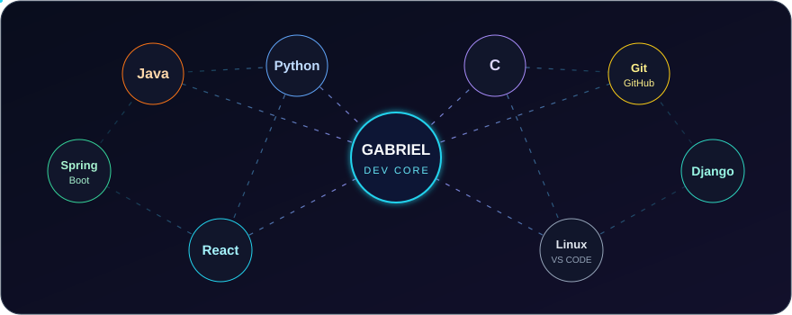
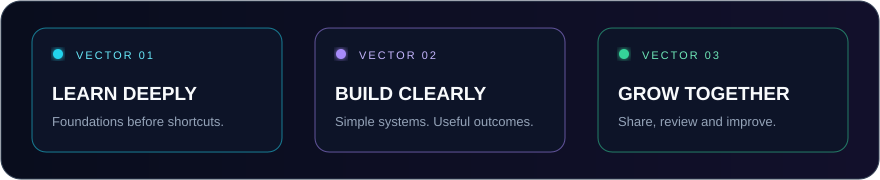

  

  

  Computer Science student at <strong>CESAR School</strong> in Recife, Brazil. 
  Exploring the space between robust backends, expressive interfaces and useful software. 
  Currently turning ideas into projects — one commit at a time.

  <code>BACKEND</code>&nbsp;&nbsp;•&nbsp;&nbsp;<code>WEB</code>&nbsp;&nbsp;•&nbsp;&nbsp;<code>OPEN SOURCE</code>&nbsp;&nbsp;•&nbsp;&nbsp;<code>CONTINUOUS LEARNING</code>

 

<h2 align="center">◈ Technology constellation</h2>

  

| Core languages | Frameworks | Environment |
|:---:|:---:|:---:|
| Java · Python · C | Spring Boot · Django | Git · GitHub · Linux · VS Code |

 

<h2 align="center">◈ Mission telemetry</h2>

  

  
  

<blockquote align="center">
  Good software is built where curiosity meets consistency.
</blockquote>

  <a href="https://github.com/bielmalta?tab=repositories"><strong>Explore my repositories →</strong></a>

  

  <a href="https://www.linkedin.com/in/gabrielgmalta/">LinkedIn</a> ·
  <a href="mailto:ggm@cesar.school">Email</a>

